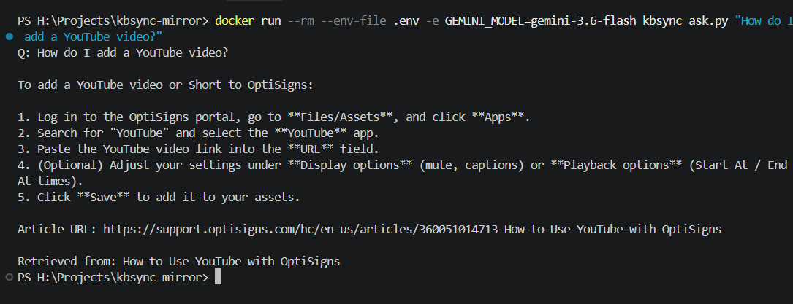

# kbsync: help-center mirror for OptiBot

> Part 2 (SCIO clone plan) is in [`part2/SCIO-clone-plan.md`](part2/SCIO-clone-plan.md).

Scrapes every published article from `support.optisigns.com` to clean Markdown, uploads it to a
**Gemini File Search store** through the API, and re-syncs it daily, uploading only what changed.

## Setup

```bash
cp .env.sample .env          # put a free key from https://aistudio.google.com/apikey in GEMINI_API_KEY
docker build -t kbsync .
```

## Run locally

```bash
docker run --rm --env-file .env kbsync                        # scrape + upload delta, then exit 0
docker run --rm -e API_KEY=... kbsync                         # same, key passed directly
docker run --rm --env-file .env kbsync ask.py "How do I add a YouTube video?"
docker run --rm -v "$PWD/articles:/app/articles" -u root kbsync main.py --scrape-only   # Markdown only
pip install -r requirements-dev.txt && pytest                 # tests, no network needed
```

Without Docker: `pip install -r requirements.txt && python main.py`.

## How it works

- **Scrape:** the Zendesk Help Center API (`/api/v2/help_center/en-us/articles.json`) returns only the article body,
  so nav, headers and widgets never enter the pipeline. Every published article is pulled (413 on 2026-10-16), not just 30.
- **Clean:** each article goes from BeautifulSoup to `markdownify` and is saved as `articles/<id>-<slug>.md`.
  - Kept: headings, code, tables, images (with their alt text), and links (relative links stay relative).
  - Fixed: Zendesk TOC anchors are re-pointed at the Markdown heading anchors, "NOTE/IMPORTANT" layout tables become blockquotes, and iframes become links.
  - Removed: scripts, styles, the marketing sign-off, and inline base64 images (their alt text is kept). One article embedded a 130 KB PNG that stalled indexing.
  - Every file starts with `# Title` and an `Article URL:` line, which is what the bot cites.
- **Chunking:** whitespace chunker, **400 tokens per chunk, 60 overlap**.
  - Articles are step-by-step guides whose sections run about 100–300 words, so a chunk usually holds a whole section plus its heading.
  - The 15% overlap keeps a step that straddles a boundary retrievable from either side.
  - The chunk count is logged as an estimate computed with the same rule, because the API does not return it.
- **Delta:** each uploaded document carries `custom_metadata` (`article_id`, `content_hash` = SHA-256 of the Markdown).
  - Each run lists the store and compares hashes: new articles are **added**; changed ones are **updated** (the new version is uploaded first, then the old one deleted); unchanged ones are **skipped**; articles that were unpublished are **removed**.
  - All state lives in the store itself, so the job is stateless and needs no database or volume.
  - Hashing the output rather than trusting `updated_at` also re-uploads articles when the cleaner itself improves.
- **Daily job:** GitHub Actions ([`daily-sync.yml`](.github/workflows/daily-sync.yml)) builds the Dockerfile and runs it at 02:17 UTC.
  - Why GitHub Actions: it is free, every run has a public log, and it runs the same Docker image, so moving to Cloud Run Jobs or a DigitalOcean job only changes the scheduler.
  - Counts are written to the run summary.
  - `runs/last_run.json`, the full log and the Markdown snapshot are kept as a run artefact.

## Daily job logs

All runs: **https://github.com/hoangtd185/kbsync-mirror/actions/workflows/daily-sync.yml**

- **First run:** 413 articles were added, about 980 chunks, in 9 minutes.
- **Later run** (`last_run.json`): only the one article whose cleaned Markdown changed was uploaded; the other 412 were skipped by hash.

```json
{
  "started_at": "2026-10-16T02:25:15+00:00",
  "articles_scraped": 413,
  "store": "fileSearchStores/optibotkb-3k1b1ekmi2gh",
  "added": 1,
  "updated": 0,
  "skipped": 412,
  "removed": 0,
  "failed": 0,
  "failed_article_ids": [],
  "files_embedded": 1,
  "chunks_embedded_estimate": 4,
  "chunks_in_store_estimate": 984,
  "chunking": {"max_tokens_per_chunk": 400, "max_overlap_tokens": 60},
  "duration_s": 9.6
}
```

## Assistant

The system prompt is used verbatim (see `ask.py`) against the same File Search store.


